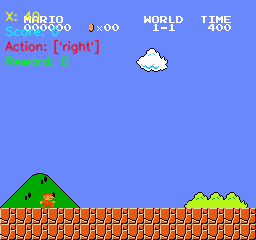
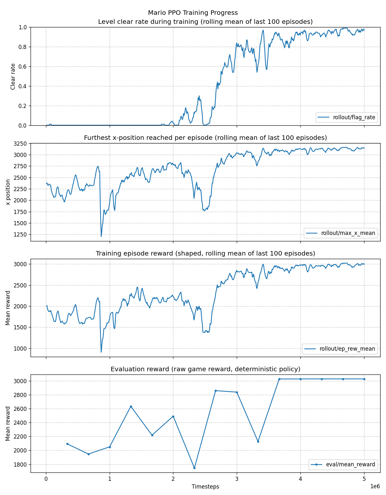
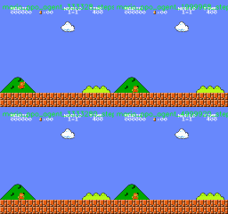

# Super Mario Bros PPO Agent

[](https://github.com/nirbhayagga/mario-ai/actions/workflows/ci.yml)

This repository trains a Reinforcement Learning agent to play Super Mario Bros using Proximal Policy Optimization (PPO) with Stable Baselines3.

## Results

Trained on World 1-1 for 10M timesteps total: 5M from scratch, then a 5M fine-tune from the best checkpoint at a lower learning rate with extra entropy (`--learning_rate 1e-4 --ent_coef 0.02`). The final agent clears the level in **10 out of 10** evaluation episodes, each started from a seeded random no-op offset and played with a deterministic policy.



| Metric (10 episodes on 1-1, base seed 42) | Value |
| :--- | :--- |
| Clear rate | 100% (10/10) |
| Mean game reward | 3029 |
| Mean episode length | 462 agent steps (about 31 seconds of play) |
| Furthest x reached | 3161 (the flag) in every episode |

Training curves for the fine-tuning leg. The from-scratch leg plateaued at roughly 90% of the level with 0% clears, stuck at the staircase before the flag. The fine-tune changed two things at once (lower learning rate, higher entropy), so neither can be credited alone, but the clear rate climbs from 0% to about 100% during it:



Four checkpoints of the fine-tuning leg playing side by side:



Reproduce (a few hours on a single consumer GPU):

```bash
python run_pipeline.py train --level 1-1 --seed 42 --n_envs 16 --total_timesteps 5000000
python run_pipeline.py train --level 1-1 --seed 42 --n_envs 16 \
    --load_model runs/1-1_5000000steps_rew_lr/best_model.zip \
    --total_timesteps 5000000 --learning_rate 1e-4 --ent_coef 0.02
python run_pipeline.py evaluate --seed 42
```

Or skip training entirely: download `best_model.zip` from the [v1.0 release](https://github.com/nirbhayagga/mario-ai/releases/tag/v1.0) and watch it play:

```bash
python run_pipeline.py evaluate --model_path best_model.zip --level 1-1
```

## Setup

Python 3.8 or 3.9 is required due to dependency constraints.

### Step 1: Create Environment

**Option A (Mamba/Conda, recommended):**
```bash
mamba create -n mario_rl python=3.9
mamba activate mario_rl
```

**Option B (Standard venv):**
```bash
python3 -m venv venv
source venv/bin/activate
```

### Step 2: Install Dependencies
```bash
pip install "pip<24.1" "setuptools==65.5.0" "wheel==0.38.4"
pip install -r requirements.txt
```

### Step 3 (optional): Development Tools
```bash
pip install -r requirements-dev.txt
ruff check .     # lint
pytest           # unit tests: CLI routing, reward/frame wrappers, checkpoint selection
```

The same lint and test steps run in CI (`.github/workflows/ci.yml`) on every push.

---

## Usage

Everything runs through `run_pipeline.py <command>`:

| Command | What it does | Needs | Produces |
| :--- | :--- | :--- | :--- |
| `validate` | Builds the exact environment stack training will use and steps it once. | Nothing | Pass/fail. |
| `train` | PPO training on one or more levels. | Nothing (optional `--load_model` to resume) | `run_config.json`, checkpoints, `best_model.zip`, `mario_ppo_final.zip`, TensorBoard logs. |
| `evaluate` | For every level of the run: runs `--eval_episodes` episodes for a per-level clear-rate table, then replays the best one and records it with a metadata overlay. | A trained run | `.mp4` + `.gif` per level, `evaluation_summary.json`. |
| `visualize` | Renders 4 evenly spaced checkpoints (first, one third, two thirds, last) side by side. | A trained run | `progress_montage.mp4` and a half-resolution `.gif`. |
| `plot` | Plots clear rate, max distance, training reward, and evaluation reward from TensorBoard logs. | A trained run | `reward_curve.png`. |
| `dashboard` | Launches TensorBoard on a run. | A trained run | Web UI. |
| `manual` | Human-controlled gameplay via keyboard. Resets on death; Escape quits. | Nothing | Nothing. |
| `all` | `validate`, `train`, `evaluate`, `visualize`, and `plot` in sequence. | Nothing | All of the above. |

`python run_pipeline.py <command> --help` lists that command's options. Unknown options are rejected. Commands that operate on a trained run take `--run_dir`; when it is omitted they use the most recently trained run under `runs/`, and they read the level and action space from the run's `run_config.json`.

### Environment options

Accepted by `validate`, `train`, `evaluate`, `visualize`, `manual`, and `all`.

| Option | Default | Description |
| :--- | :--- | :--- |
| `--level` | `1-1` | Target level, e.g. `1-1` or `1-1-v3`. Comma-separated for multi-level (`1-1,1-2,2-1`). Commands on a trained run default to the run's level. |
| `--action_space` | `simple` | Movement space: `simple` (7 actions), `right_only` (5 actions - recommended for speed), or `complex` (12 actions). Commands on a trained run default to the run's action space. |
| `--no_custom_reward` | off | Disables stuck penalty, early termination, reward clipping, and random no-op starts (`validate`, `train`, `all`). |

### Training options

Accepted by `train` and `all`.

| Option | Default | Description |
| :--- | :--- | :--- |
| `--run_dir` | derived | Directory to write the run to. Defaults to `runs/<level>_<timesteps>steps[_rew][_lr][_resume][_<action_space>]`. |
| `--total_timesteps` | `2000000` | Total training steps. |
| `--n_envs` | `4` | Parallel environments. For multi-level, levels cycle across envs. |
| `--no_lr_schedule` | off | Disables linear learning rate decay. |
| `--load_model` | none | Path to a `.zip` model to resume from. Every hyperparameter given on the command line applies on resume. |
| `--save_freq` | auto | Checkpoint save frequency in env steps. Auto-computed for ~15 checkpoints if not set. |
| `--device` | `auto` | `auto` (CUDA if available, else CPU), `cuda`, or `cpu`. Also accepted by `evaluate` and `visualize`. |
| `--seed` | none | Seeds PPO, numpy/torch, and every environment (including random no-op starts). Also accepted by `evaluate`. Two seeded CPU runs are bit-identical. |

### PPO Hyperparameters

Accepted by `train` and `all`; the defaults live in `src/train.py` and are based on community benchmarks for Super Mario Bros:

| Option | Default | Rationale |
| :--- | :--- | :--- |
| `--n_steps` | `512` | Shorter rollouts converge faster for Mario. Longer buffers (2048) dilute the learning signal. |
| `--gamma` | `0.99` | High discount factor prioritizes reaching the flagpole over grabbing local coins. |
| `--batch_size` | `256` | Larger batches stabilize gradients with the clipped reward range. |
| `--ent_coef` | `0.01` | Entropy bonus encourages exploration and prevents the agent from getting stuck in loops. |
| `--vf_coef` | `0.5` | Balanced actor-critic weighting, standard for PPO. |
| `--clip_range` | `0.1` | Tighter clipping than the SB3 default (0.2) prevents catastrophic policy swings. |
| `--n_epochs` | `10` | Sufficient optimization passes per batch without overfitting to the rollout. |
| `--learning_rate` | `2.5e-4` | SB3 default. Paired with linear decay (disable with `--no_lr_schedule`). |
| `max_grad_norm` | `0.5` | Fixed. Gradient clipping prevents catastrophic policy updates during long runs. |

### Evaluation options

Accepted by `evaluate` and `all`.

| Option | Default | Description |
| :--- | :--- | :--- |
| `--run_dir` | latest run | Run to evaluate (`evaluate` only; `visualize`, `plot`, and `dashboard` take it too). |
| `--model_path` | `best_model.zip` | Model to evaluate; falls back to `mario_ppo_final.zip` (`evaluate` only). |
| `--video_output` | `<run_dir>/evaluation_run.mp4` | Output video path; a `.gif` is written alongside (`evaluate` and `visualize`). |
| `--max_steps` | `3000` | Maximum steps per episode (stops earlier on level clear or death). |
| `--eval_episodes` | `10` | Episodes per level for the clear-rate summary, each from a seeded random no-op start. The best episode (clears first, then furthest x) is replayed and recorded. |
| `--video_speed` | `2.0` | Playback speed relative to real time. `1.0` writes real-time video at 15 fps; the GIF drops frames to stay near 15 fps at any speed. |

### Montage options

Accepted by `visualize` and `all`.

| Option | Default | Description |
| :--- | :--- | :--- |
| `--checkpoint_dir` | `<run_dir>/checkpoints` | Directory containing checkpoints (`visualize` only). |
| `--num_steps` | `1000` | Steps rendered per checkpoint. |

`dashboard` additionally accepts `--port` (default `6006`).

---

## Recommended Configurations

### Single-Level Training (e.g. mastering 1-1)

```bash
python run_pipeline.py train --level 1-1 --total_timesteps 5000000 --n_envs 8
```

* **Timesteps**: budget 10M for a World 1 level (5M from scratch reached 0% clears on 1-1; see the result above), more for harder levels (castles, underwater).
* **Envs**: 4-8 on a standard GPU, up to 24 if you have the VRAM/CPU cores.
* **Reward/LR**: Custom rewards and LR schedules are enabled by default for optimal convergence.
* **Action Space**: Use `--action_space right_only` to reduce the action space from 7 to 5, significantly speeding up training by preventing Mario from walking backward.
* **Checkpoints**: Auto-computed for ~15 checkpoints per run. Override with `--save_freq`.

### Multi-Level Training (e.g. World 1)

```bash
python run_pipeline.py train --level 1-1,1-2,1-3,1-4 --total_timesteps 15000000 --n_envs 16
```

* **Timesteps**: ~3-5M per level in the set (so 4 levels = 12-20M).
* **Envs**: Use at least 4x the number of levels (e.g. 16 envs for 4 levels). Levels cycle evenly across envs.
* **Entropy**: Consider `--ent_coef 0.02` for more exploration; it was part of the recipe that got 1-1 past its plateau, not only a multi-level setting.
* **Evaluation**: `best_model.zip` is selected on the mean evaluation reward across all levels in the set, and `evaluate` reports clear rate per level.

### Fine-Tuning from Checkpoint

```bash
python run_pipeline.py train --level 1-1 \
    --load_model runs/1-1_5000000steps_rew_lr/best_model.zip \
    --total_timesteps 5000000 --n_envs 16 --learning_rate 1e-4 --ent_coef 0.02
```

* These are the settings that took 1-1 from 0% to 10/10 clears. Use a lower learning rate than the from-scratch run (1e-4 down to 2.5e-5) to refine without destroying learned behavior.
* The linear LR schedule applies automatically on resume (disable with `--no_lr_schedule`).

### Which Map Version to Use

Each level has 4 visual variants (`-v0` through `-v3`). Append to the level (e.g. `--level 1-1-v0`).

| Version | Description | Use For |
| :--- | :--- | :--- |
| `-v0` | Original NES graphics | **Training and video output (recommended)**. Full-detail sprites give the CNN the most information. |
| `-v1` | Downsampled sprites | Research only. Loses detail without clear benefit since we already resize to 84x84. |
| `-v2` | Pixel-only, black background | Research only. Removes background but also removes useful spatial cues. |
| `-v3` | Sprites only, no background | Research only. Cleaner signal but agents trained on v3 don't transfer to v0. |

**TL;DR**: Always use `-v0` (the default). It gives the best training signal and the best-looking evaluation videos.

---

## Examples

The natural order is `validate`, `train`, then `evaluate`, `visualize`, and `plot` on the resulting run; `dashboard` can run during training and `manual` at any time.

Validate the environment:
```bash
python run_pipeline.py validate --level 1-1
```

Train on a single level:
```bash
python run_pipeline.py train --level 1-1 --total_timesteps 5000000 --n_envs 8
```

Train with a fixed seed so the run can be reproduced exactly on CPU:
```bash
python run_pipeline.py train --level 1-1 --seed 42
```

Train on multiple levels simultaneously:
```bash
python run_pipeline.py train --level 1-1,1-2,2-1,3-1 --total_timesteps 15000000 --n_envs 16
```

Evaluate the most recent run (gameplay video with overlay plus a 10-episode clear-rate table per level):
```bash
python run_pipeline.py evaluate
```

Evaluate a specific run at real-time playback speed:
```bash
python run_pipeline.py evaluate --run_dir runs/1-1_5000000steps_rew_lr --video_speed 1
```

Render a side-by-side checkpoint comparison montage, plot the training curves, and open TensorBoard:
```bash
python run_pipeline.py visualize --run_dir runs/1-1_5000000steps_rew_lr
python run_pipeline.py plot --run_dir runs/1-1_5000000steps_rew_lr
python run_pipeline.py dashboard --run_dir runs/1-1_5000000steps_rew_lr
```

Play Mario manually (arrow keys to move, Down to crouch/enter pipe, Space/Up to jump, Shift to sprint, Z to climb, Escape to quit):
```bash
python run_pipeline.py manual --level 1-1
```

Run the full pipeline end to end:
```bash
python run_pipeline.py all --level 1-1 --total_timesteps 5000000 --n_envs 8
```

---

## Level Types

The 32 levels fall into four categories requiring different AI strategies:

* **Overworld**: Classic platforming (e.g. 1-1, 2-1).
* **Underground**: Ceiling-constrained stages (e.g. 1-2, 4-2).
* **Underwater**: Swimming physics (e.g. 2-2, 7-2).
* **Castle**: Firebars, lava, and timing hazards (e.g. 1-4, 8-4).

### Level Reference

| World | Stage 1 | Stage 2 | Stage 3 | Stage 4 |
| :--- | :--- | :--- | :--- | :--- |
| 1 | 1-1 (Over) | 1-2 (Under) | 1-3 (Over) | 1-4 (Castle) |
| 2 | 2-1 (Over) | 2-2 (Water) | 2-3 (Over) | 2-4 (Castle) |
| 3 | 3-1 (Over) | 3-2 (Over) | 3-3 (Over) | 3-4 (Castle) |
| 4 | 4-1 (Over) | 4-2 (Under) | 4-3 (Over) | 4-4 (Castle) |
| 5 | 5-1 (Over) | 5-2 (Over) | 5-3 (Over) | 5-4 (Castle) |
| 6 | 6-1 (Over) | 6-2 (Under) | 6-3 (Over) | 6-4 (Castle) |
| 7 | 7-1 (Over) | 7-2 (Water) | 7-3 (Over) | 7-4 (Castle) |
| 8 | 8-1 (Over) | 8-2 (Over) | 8-3 (Over) | 8-4 (Castle) |

---

## Directory Organization

* `src/`: Python source modules.
* `runs/`: Each experiment generates an isolated folder using the pattern `<level>_<timesteps>steps[_rew][_lr][_resume][_<action_space>]` (or the path given by `--run_dir`):
    * `run_config.json`: Every training flag plus the command line, git commit, and timestamp, so the run can be reproduced and located with `--run_dir`.
    * `tensorboard/`: TensorBoard event logs.
    * `checkpoints/`: Periodic model snapshots.
    * `eval_logs/`: Evaluation results from `EvalCallback`.
    * `best_model.zip`: Best-performing model weights (selected by periodic evaluation on unshaped game reward with random no-op starts across every level of the run, protects against catastrophic forgetting).
    * `mario_ppo_final.zip`: Final trained model weights (may be worse than best_model due to policy collapse).
    * `evaluation_run.mp4` / `evaluation_run.gif`: The best evaluation episode, with overlay (the GIF embeds in GitHub READMEs). Multi-level runs write one pair per level, e.g. `evaluation_run_1-2.mp4`.
    * `evaluation_summary.json`: Per-level clear rate, mean reward, and max distance across `--eval_episodes` episodes.
    * `progress_montage.mp4` / `progress_montage.gif`: Side-by-side checkpoint comparison (the GIF is half resolution at 10 fps so it stays embeddable).
    * `reward_curve.png`: Training and evaluation reward curves.

---

## License

MIT. See `LICENSE`.
